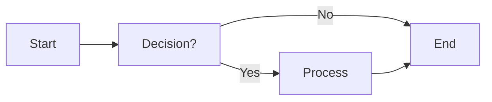

# Bart project

> 使用 HTML、JS 等 Web 技术构建的项目，采用 TDD（测试驱动开发）开发模式。

## 目录
- [技术栈](#技术栈)
- [项目流程](#项目流程)
- [快速开始](#快速开始)

---

### 技术栈
本项目主要涉及以下核心技术：
* JS (JavaScript)
* Python
* TypeScript
* Java
* Web Server

---

### 项目流程


---

### 快速开始
运行以下 Python 脚本进行环境测试：

```python
print("Hello world")
```
